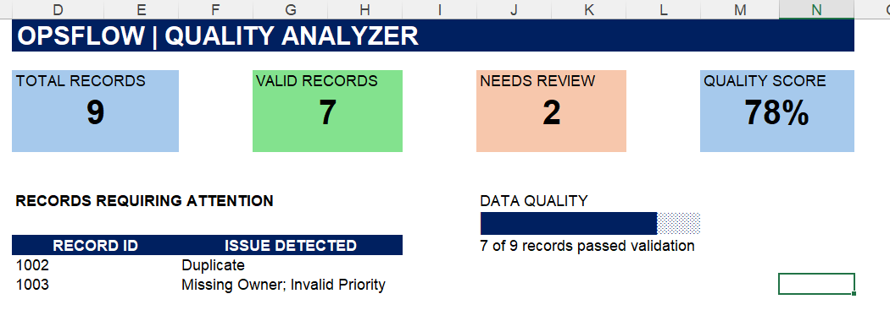

# OpsFlow — Operations Quality Analyzer

A **refreshable, Excel-based data-quality tool** built as a hands-on project to practice business process improvement, low-code automation, functional testing, and dashboard design.

## The problem

Checking operational records one by one for missing fields, duplicate IDs, and unexpected values is repetitive and makes mistakes easier to overlook. OpsFlow demonstrates how predefined validation rules can surface records needing attention in a single view.

## What it does

- Checks for **missing owners**, **duplicate record IDs**, and **invalid priority values** (allowed: High, Medium, Low).
- Uses Power Query to compare each record's row index with the first occurrence of its ID, flagging later occurrences rather than deleting them.
- Combines multiple problems into a single **Issue Details** field (for example, `Missing Owner; Invalid Priority`).
- Labels records `Valid` or `Needs Review` and calculates total, valid, exception, and quality-score metrics.
- Displays a refreshable dashboard with KPI cards, an exception list, and a visual quality indicator.

## Tools and approach

- **Microsoft Excel (desktop)** — source table, formulas, and dashboard
- **Power Query** — transformations and validation rules
- **Excel `FILTER`, `COUNTIF`, `COUNTA`, `IFERROR`, and `REPT`** — dynamic exception display and metrics

The tool is **refresh-driven**, not a continuously running service: source edits appear in the results after **Data → Refresh All**.

## Reproduce the demo

> Download OpsFlow_Demo.xlsx from this repository and open it in Microsoft Excel to explore the working quality analyzer.

1. Open `OpsFlow_Demo.xlsx` in a desktop version of Excel that supports Power Query and dynamic-array `FILTER` formulas (such as Microsoft 365 Excel).
2. Open the `OpsFlowRecords` worksheet. It contains synthetic demonstration records; edit **only this source sheet**.
3. Choose **Data → Refresh All** to recompute `FirstOccurrenceLookup`, `Quality Results`, and the dashboard.
4. Open `Dashboard` and check the metrics and the `Records Requiring Attention` list.
5. Open `Quality Results` to inspect the per-record `Owner Check`, `Duplicate Check`, `Priority Check`, `Overall Status`, and `Issue Details` fields.

### Expected demo state

The final tested dataset contains **9 records**. Seven are valid, and two require review, giving a displayed quality score of **78%** (7/9 rounded to a whole percentage).

| Record | Expected issue |
|---|---|
| Second occurrence of `1002` | Duplicate |
| `1003` | Missing Owner; Invalid Priority |

You can compare with the screenshot above. An example synthetic input is available in [`sample_data.csv`](sample_data.csv); it is a reference for the demo records, not a replacement for the finished workbook.

## Tests performed

| Test | Expected behavior | Result |
|---|---|---|
| Correct an invalid priority | Previously flagged record becomes valid after refresh | Passed |
| Add a valid record | Total and valid counts increase after refresh | Passed |
| Put two errors in one record | Both errors appear; record is counted only once as needing review | Passed |
| Add additional invalid records | Exception list expands and quality score recalculates | Passed |
| Restore the demonstration data | Dashboard returns to 9 total / 7 valid / 2 review / 78% | Passed |

## Limitations and potential improvements

- Refresh must be triggered in Excel; this is not an unattended automation.
- The workflow demonstrates a small synthetic dataset, not performance at business scale.
- Duplicate detection treats the **first occurrence** of an ID as the original, based on its source-table position.
- The dashboard uses Excel dynamic-array formulas and requires an appropriately compatible Excel version.
- Possible next steps: configurable validation rules, more robust handling of blank/whitespace values, documented performance tests, and a simplified data-entry experience.

## Privacy and scope

This is a **personal learning/portfolio project using synthetic data**. It was not deployed as an employer system. No production outcomes, labor savings, or business impact are claimed. Only a sanitized workbook and screenshot should be published; remove metadata, external connections, customer information, and employer-specific content before uploading.
